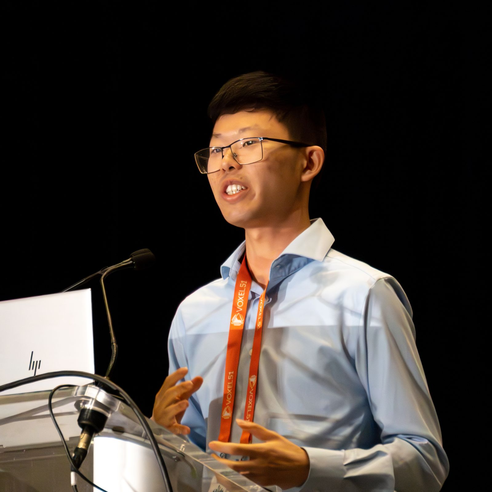
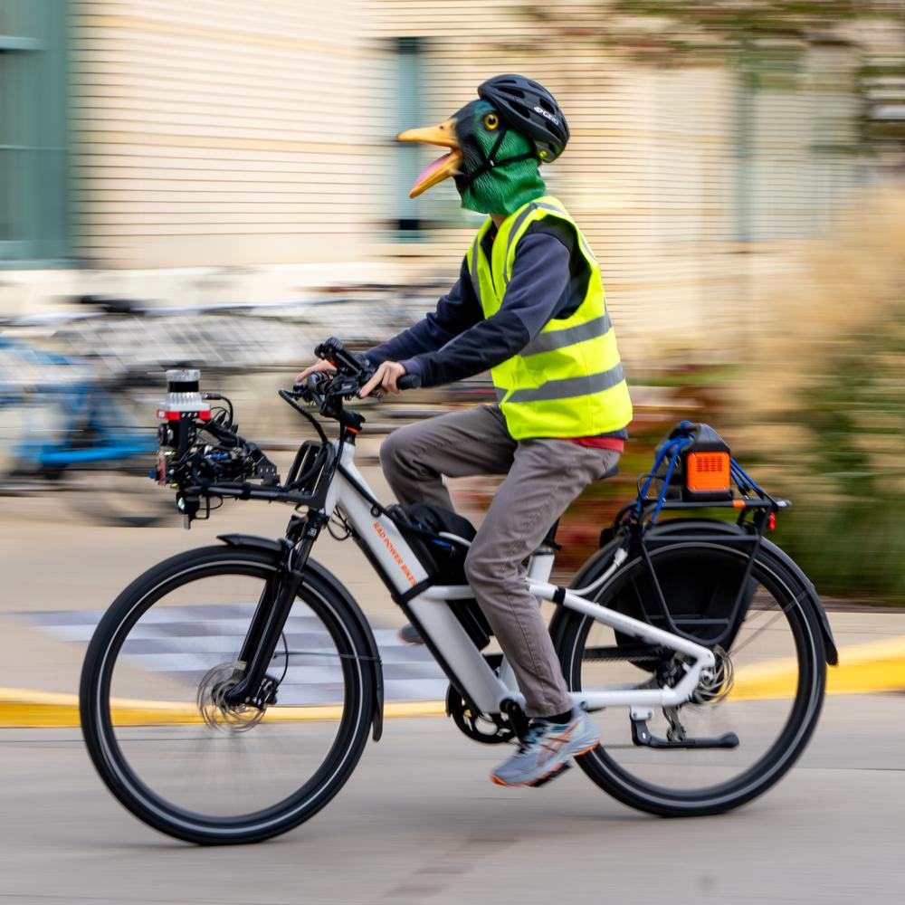
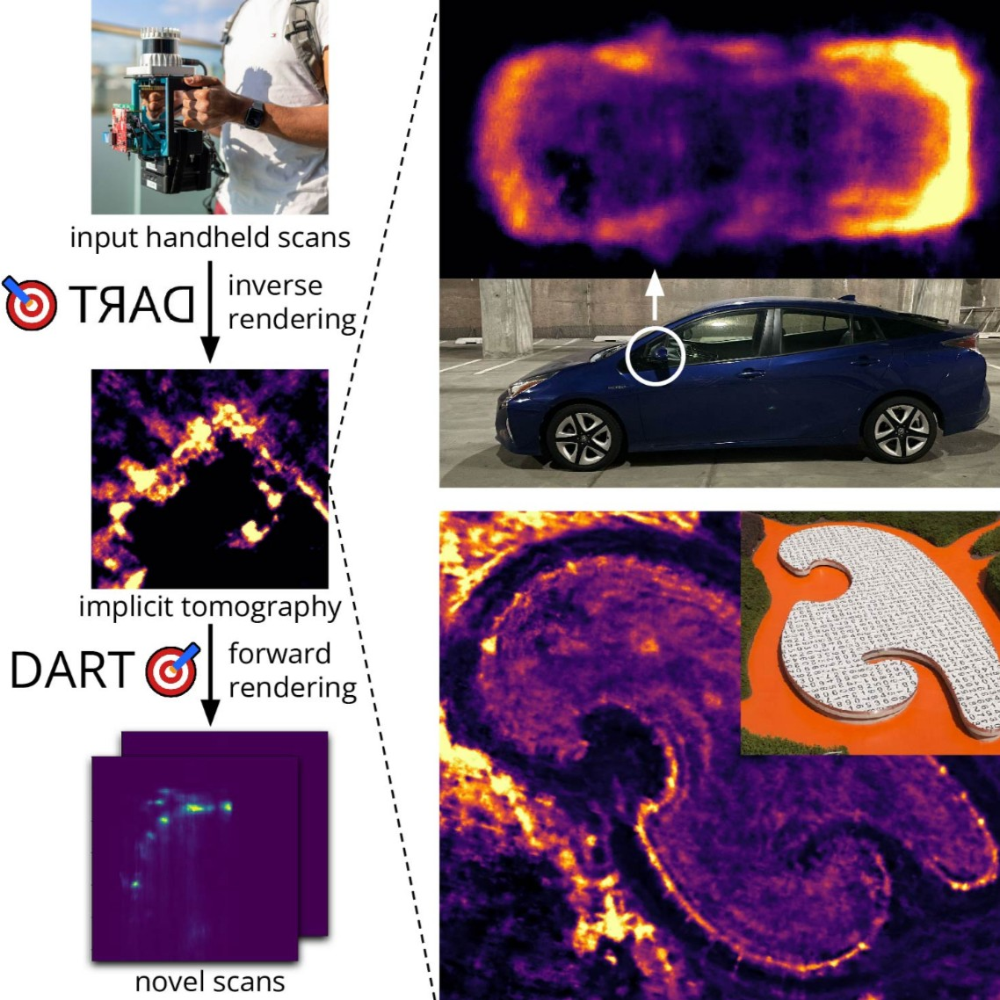
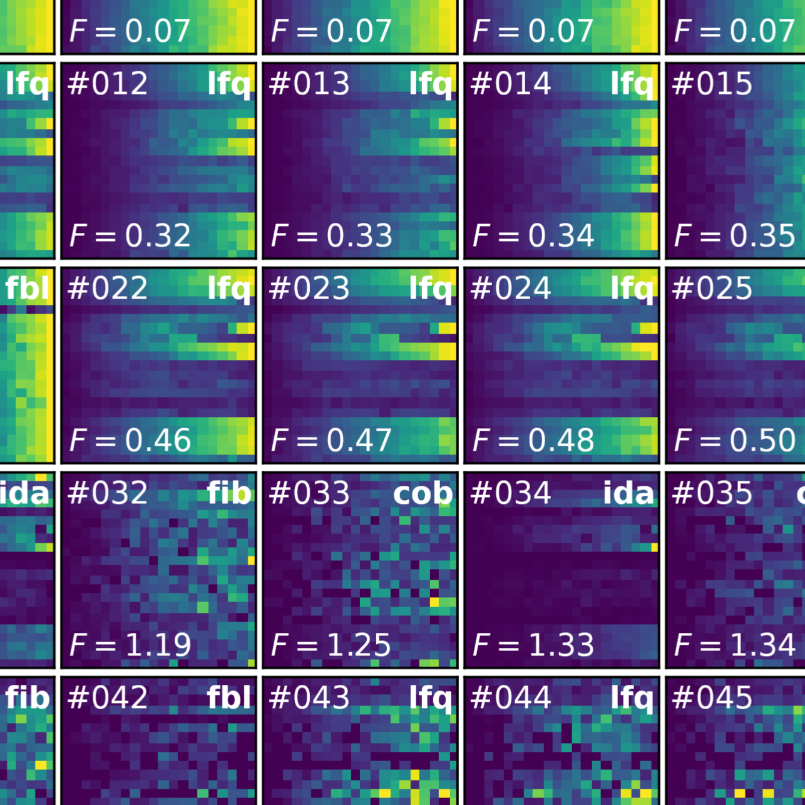
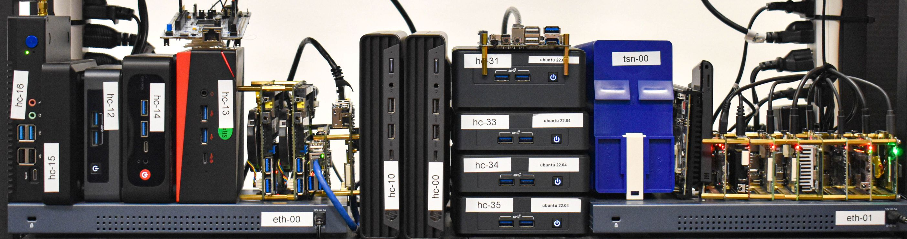

---
hide:
- navigation
---

<h1 style="font-size: 70px; margin-bottom: 30px; font-weight: 100">Tianshu Huang</h1>

  Fall 2027 &middot; Machine Learning &middot; Sensing &middot; Cyber-Physical Systems
  
On the Academic Job Market!

  
I'm seeking tenure-track faculty positions starting Fall 2027. I'm excited to share my work and future research plans with prospective colleagues and departments; feel free to reach out if you'd like to connect!

  <!--
  

    <a href="#">CV</a>
    <a href="#">Research Statement</a>
    <a href="#">Teaching Statement</a>
  

  -->

</img>

I am a PhD student co-advised by [Anthony Rowe][?] and [Carlee Joe-Wong][?] at the Department of [Electrical and Computer Engineering](https://www.ece.cmu.edu/) at Carnegie Mellon University. I reached All But Dissertation status in August 2025.

My research interest lies broadly in learning for cyber-physical systems &mdash; applying machine learning to systems in ways that leverage both data-driven learning techniques and a low-level understanding of system properties &mdash; and taking a systems approach to machine learning. While my current work focuses on foundation models for [radar perception](research.md) and other sensors, signals, and systems, I consider myself to be applied ML generalist, with [my work](research.md) drawing from techniques across statistics and machine learning literature.

Previously, I obtained my B.S. in Electrical Engineering at the University of Texas at Austin in May 2021, where I worked on Learning to Optimize with [Atlas Wang][?].

Please contact me at <a href="mailto:tianshu2@andrew.cmu.edu">tianshu2@andrew.cmu.edu</a>. In addition to my [research](research.md) and [open-source](open-source.md) portfolio, you can find my Google Scholar page [here](https://scholar.google.com/citations?user=ZcVpdxQAAAAJ) and my GitHub page [here](https://github.com/thetianshuhuang); I also have a [photography page](photography.md).

---

    
    
    

## Teaching

::: teaching

## Students

::: students

## Awards

::: awards

## Service

::: service
