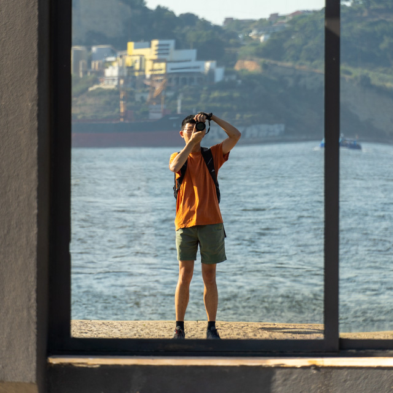

---
hide:
- navigation
---

# Tianshu Huang / **Photography**

</img>

I'm an amateur photographer who mostly takes travel photos; recently, I've also been dabbling in events and other research-related work. I started (somewhat) seriously trying to learn photography in 2022; this page documents my best work so far.

::: photos
