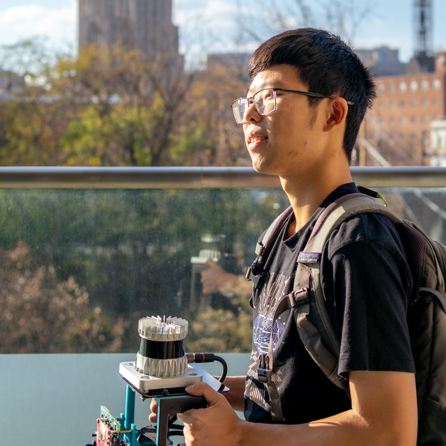

---
hide:
- navigation
---

# Tianshu Huang / **Research**

</img>

My past and current work spans a wide range of topics in machine learning, including foundation models ([ICCV '25](#grt)), statistical learning ([MLSys '25](#pitot)), NeRF-style neural-implicit inverse rendering ([CVPR '24](#dart)), and meta-learning ([ICLR '22](#l2o)). I also actively support systems researchers by providing machine learning, statistics, and data science expertise ([SIGGRAPH '26](#istc), [OOPSLA '25](#beanstalk), [RTAS '25](#silverline), [EuroSys '25](#wali)), while also supporting machine learning researchers working with real-world sensors and systems ([3DV '26](#radarsim)).

Currently, I'm focused on scaling and building out foundational models for low-level spectrum-based radar perception, as well as establishing an ecosystem and community for radar research more broadly via the [RadarML open source initiative](https://radarml.github.io/) and Radar Interest Group @ CMU.

## Publications

::: publications

## Patents

::: patents

## Conference & Invited Talks

::: talks
